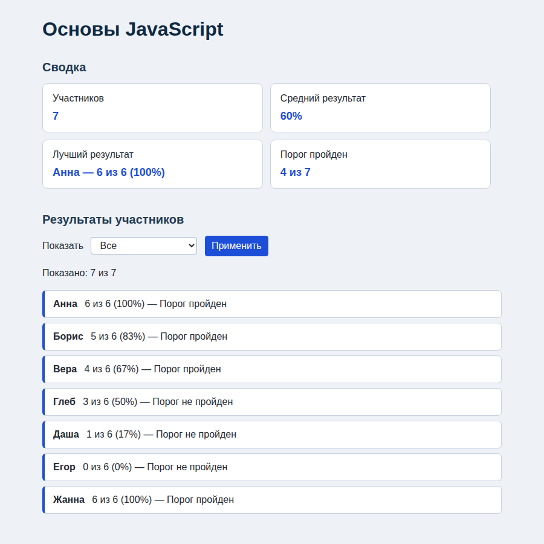

# quiz-report

Генератор HTML-отчёта по результатам викторины: Node.js читает JSON, считает статистику и создаёт страницу с фильтром участников.

[](https://github.com/radif-ru/quiz-report/actions/workflows/ci.yml)
[](https://nodejs.org/)
[](https://nodejs.org/api/esm.html)
[](https://developer.mozilla.org/docs/Web/HTML)
[](https://developer.mozilla.org/docs/Web/CSS)
[](src/package.json)
[](test)

Проект выполнен в рамках модуля «Основы Computer Science, JavaScript и Node.js»
программы профессиональной переподготовки «Вайб-кодинг: разработка приложений
с помощью AI» [Цифровой кафедры НИЯУ МИФИ](https://icis.mephi.ru/digital-department)
(федеральный проект «Университеты для поколения лидеров»).

## Задача

Файл `data/results.json` содержит название викторины, ключ правильных ответов
и ответы участников. Генератор проверяет структуру данных, считает для каждого
участника число верных ответов, процент и прохождение порога 67%, собирает
сводку и записывает `report.html`. Страница отчёта открывается двойным кликом,
без сервера, и фильтрует участников: все, прошедшие и не прошедшие порог.

**Сам проект — ровно семь файлов в `src/`**: `package.json`, `generator.js`,
`stats.js`, `report.html`, `style.css`, `app.js` и `data/results.json`. Всё
остальное в репозитории — тесты и CI вокруг них.

## Принципы реализации

- Проект собран на исходной заготовке: готовые функции `escapeHtml()`,
  `serializeForScript()`, `createAttemptMarkup()`, `createReportHtml()`,
  `removePreviousReport()`, `fail()` и `isArray()` не изменены — тесты сверяют
  их SHA-256 с исходным текстом.
- `src/package.json` объявляет `"type": "module"`, `generator.js` импортирует
  `calculateReport` и `validateQuizData` из `stats.js`.
- `validateQuizData()` проверяет семь условий: корень — объект, непустые
  `quizTitle`, `correctAnswers` и `attempts`, каждая попытка — объект с
  непустым после `trim()` именем и массивом ответов нужной длины. Все проверки
  массивов — через `isArray()`.
- `calculateAttempt()` возвращает ровно четыре поля, `calculateReport()` —
  ровно восемь; средний результат считается по уже округлённым процентам, при
  равном счёте лучшим остаётся первый участник.
- `main()` соблюдает порядок из условия: путь из `process.argv[2]`, удаление
  старого отчёта, `await readFile()` со своей обработкой ошибки, только
  `JSON.parse()` в отдельном `try...catch`, проверка структуры, расчёт,
  `await writeFile()` и сводка только после успешной записи. Ожидаемые ошибки
  завершают работу через `fail()` с кодом 1.
- `app.js`: `selectAttempts()` фильтрует `window.reportData.attempts`,
  `renderAttempts()` собирает строки через `forEach()` и строковый
  аккумулятор, пропуская имя через `escapeHtml()`, `startFilter()` находит
  элементы через `querySelector()` и обновляет счётчик и список по `submit`
  без перезагрузки.
- Стили — без Flexbox и Grid: карточки сводки и строки участников белые на
  сером фоне страницы.
- Без зависимостей: для запуска не нужны `npm install` и сеть, тесты — на
  встроенном `node:test`.

## Запуск

Нужен Node.js 20 или новее:

```bash
cd src
npm start -- ./data/results.json
```

После запуска откройте `src/report.html` двойным кликом.

## Пример работы

```text
Участников: 7
Средний результат: 60%
Лучший результат: Анна — 6 из 6 (100%)
Порог пройден: 4 из 7
Отчёт: report.html
```



| Фильтр | Счётчик | Участники |
|--------|---------|-----------|
| Все | Показано: 7 из 7 | Анна, Борис, Вера, Глеб, Даша, Егор, Жанна |
| Порог пройден | Показано: 4 из 7 | Анна, Борис, Вера, Жанна |
| Порог не пройден | Показано: 3 из 7 | Глеб, Даша, Егор |

## Проверки

```bash
npm run check    # node --check для app.js, stats.js и generator.js
npm test         # node --test: stats.js, сценарии генератора, фильтр страницы, состав src/
```

| Проверка из условия | Ожидается | Чем покрыто |
|---------------------|-----------|-------------|
| `check-stats.js` | точный вывод из условия | `test/stats.test.js` |
| Контрольный запуск | пять строк сводки, новый `report.html` | `test/generator.test.js`, шаг CI с `npm start` |
| Нет файла | `Ошибка чтения файла: ENOENT`, код 1, отчёта нет | `test/generator.test.js` |
| Сломанный JSON | `Ошибка данных`, код 1, отчёта нет | `test/generator.test.js` |
| Пять ответов при ключе из шести | `Ошибка структуры данных`, код 1, отчёта нет | `test/generator.test.js` |
| Первый ответ Егора — 1 | средний 62%, Егор 1 из 6 (17%) | `test/generator.test.js` |
| Фильтры all, passed, failed | 7, 4 и 3 участника | `test/app.test.js` |
| Состав папки, готовые функции, нет TODO | ровно семь файлов, SHA-256 совпадают | `test/sources.test.js`, шаг CI |

В [GitHub Actions](.github/workflows/ci.yml) генератор дополнительно
запускается через `npm start` без установки зависимостей, а `git diff`
подтверждает, что сохранённый `report.html` совпадает со свежим.

## Структура проекта

```text
.
├── .github/
│   └── workflows/
│       └── ci.yml            # синтаксис, тесты, состав src/, контрольный запуск
├── src/                      # сдаваемый проект — ровно семь файлов
│   ├── data/
│   │   └── results.json      # контрольные ответы участников
│   ├── app.js                # фильтр участников на странице
│   ├── generator.js          # чтение JSON, проверки, запись report.html
│   ├── package.json          # ESM и скрипт start
│   ├── report.html           # отчёт, созданный генератором
│   ├── stats.js              # проверка данных и расчёт статистики
│   └── style.css             # оформление без Flexbox и Grid
├── test/
│   ├── app.test.js           # фильтр в node:vm на DOM-стабе
│   ├── generator.test.js     # сквозные сценарии в копиях проекта
│   ├── sources.test.js       # состав папки, готовые функции, стили
│   └── stats.test.js         # validateQuizData, calculateAttempt, calculateReport
├── docs/
│   └── images/
│       └── quiz-report.png   # отчёт в браузере
├── .gitignore
├── package.json              # скрипты check и test
└── README.md
```

---

Автор — [Радиф Илалтдинов](https://radif.ru)
